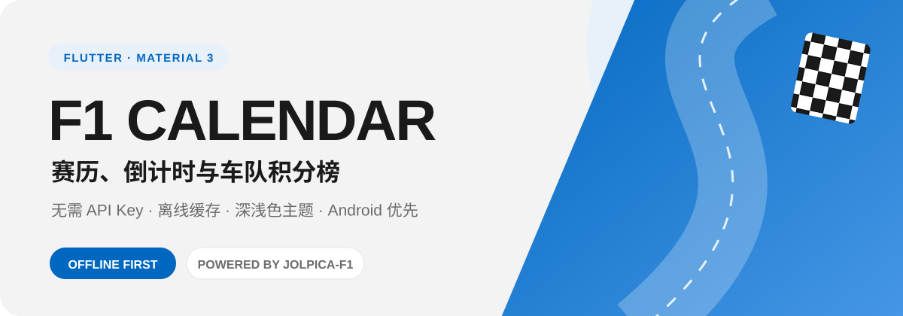
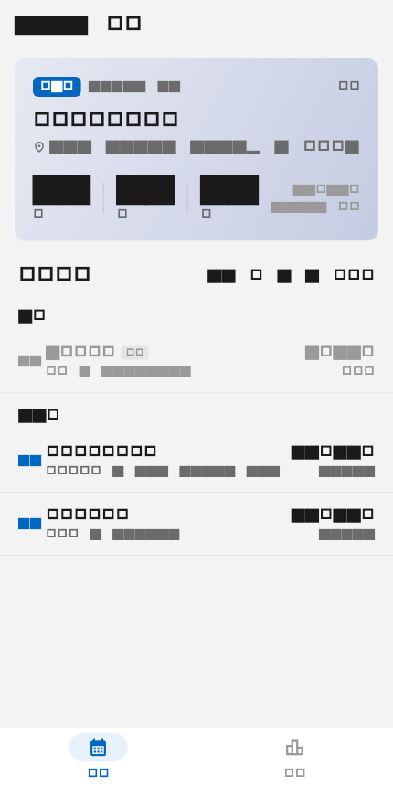
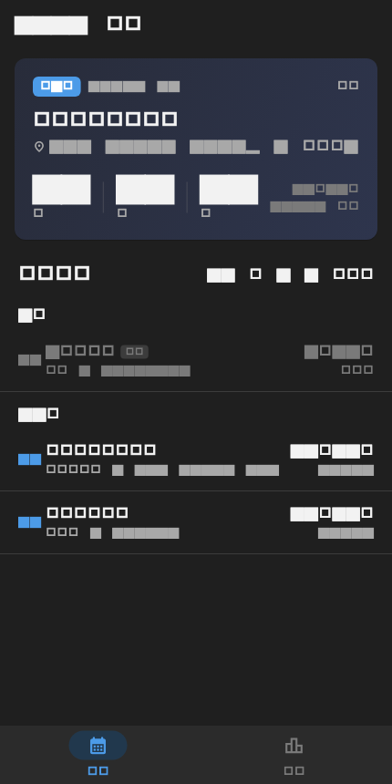
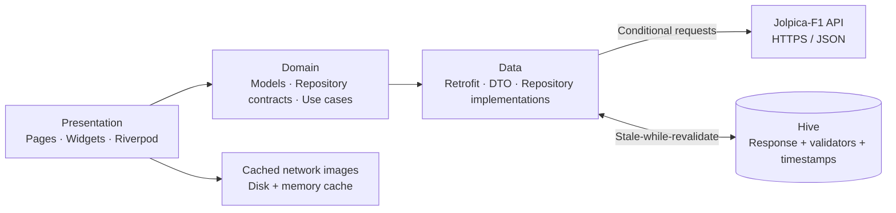

<div align="center">

<picture>
  <source media="(prefers-color-scheme: dark)" srcset="docs/assets/header-dark.svg">
  <source media="(prefers-color-scheme: light)" srcset="docs/assets/header-light.svg">
  
</picture>

# F1 Calendar · F1 赛历

**把整季赛历、下一场倒计时和车队积分榜装进口袋。**

[](https://flutter.dev)
[](https://dart.dev)
[](android)
[](https://api.jolpi.ca/ergast/f1)
[](LICENSE.md)

[功能特性](#功能特性) · [快速开始](#快速开始) · [架构设计](#架构设计) · [参与贡献](CONTRIBUTING.md) · [许可说明](#许可与第三方声明)

</div>

> [!IMPORTANT]
> 本仓库采用 **PolyForm Noncommercial 1.0.0**：允许查看、修改和非商业使用，**禁止未经授权的商业使用**。它属于源码可用（source-available）许可证，而非 OSI 定义的开源许可证。作者保留自行上架应用商店及商业化的权利。

## 界面预览

<div align="center">
  
  &nbsp;&nbsp;
  
</div>

<sub>预览图由仓库中的真实 Flutter 组件生成，使用固定示例数据，避免截图随时间变化。</sub>

## 功能特性

| 模块 | 已实现能力 |
| --- | --- |
| 整季赛历 | 按月份分组展示分站、赛道、本地发车时间与冲刺赛标识，分站数量由接口返回决定 |
| 下一场比赛 | 自动识别最近一场未开赛分站，显示天、时、分倒计时和赛道信息 |
| 分站详情 | 展示练习赛、排位赛、正赛等周末日程，以及已产生的正赛结果 |
| 车队积分榜 | 展示名次、积分、胜场与名次变化，支持车队详情和车手信息 |
| 离线缓存 | 优先渲染缓存，后台刷新；网络失败且有缓存时继续展示旧数据 |
| 视觉体验 | Material 3、浅色/深色主题、克制的队色与分站渐变、平滑页面转场 |

**无需 API Key，无需自建服务器。** 数据来自免费的 [Jolpica-F1](https://api.jolpi.ca/ergast/f1) 接口。

> [!NOTE]
> “离线可用”指已缓存的赛历、积分和图片可以继续查看。首次获取数据或更新未缓存内容时仍需联网。

## 快速开始

### 环境要求

- Flutter **3.47.9**（Dart **3.13.7**）
- Android 真机或模拟器
- 构建 APK 时需要 Android SDK 与 **JDK 17**

### 安装与运行

克隆本仓库后，在项目根目录执行：

```bash
flutter pub get
flutter run
```

构建 Android 安装包：

```bash
flutter build apk
```

生成产物位于 `build/app/outputs/flutter-apk/app-release.apk`，该目录已被 Git 忽略。

> [!WARNING]
> 当前 `release` 构建沿用 Flutter 模板的调试签名，仅便于本地运行。**上传应用商店前必须配置你自己的正式签名**，并妥善保管 keystore 与密码；这些文件不应提交到 GitHub。

<details>
<summary><strong>修改模型或接口后，如何重新生成代码？</strong></summary>

仓库已包含 `*.freezed.dart` 和 `*.g.dart`。只有修改 Freezed 模型、JSON 字段或 Retrofit 接口后才需要重新生成：

```bash
dart run build_runner build --delete-conflicting-outputs
```

</details>

## 架构设计

采用按功能分层的结构，让 UI、领域规则和远程/本地数据实现各自独立：



### 缓存策略

| 内容 | TTL / 策略 | 弱网与断网行为 |
| --- | --- | --- |
| 赛历 | 24 小时 | 先显示缓存，过期后后台刷新 |
| 车队积分 | 5 分钟 | 网络失败时回退到旧缓存 |
| HTTP 响应 | ETag / Last-Modified | 服务端返回 304 时复用正文 |
| 车图与头像 | 磁盘 + 内存缓存 | 已缓存图片离线显示 |

### 技术选型

| 用途 | 选择 |
| --- | --- |
| 状态管理 | `flutter_riverpod`：AsyncNotifier 与 AsyncValue 三态 |
| 路由 | `go_router`：StatefulShellRoute 保留各 Tab 导航栈 |
| 网络 | `dio` + `retrofit`：统一超时、条件请求与接口生成 |
| 数据模型 | `freezed` + `json_serializable` |
| 本地缓存 | `hive` / `hive_flutter` |
| 图片缓存 | `cached_network_image` |
| 时间与本地化 | `intl`、`flutter_localizations` |

<details>
<summary><strong>展开项目目录</strong></summary>

```text
lib/
├── main.dart                       # 初始化 intl、Hive 与 ProviderScope
├── app/
│   ├── providers.dart              # Dio、缓存、赛季等基础设施 Provider
│   ├── router.dart                 # 路由表与底部 NavigationBar 外壳
│   └── theme.dart                  # Material 3 主题与设计 Token
├── core/
│   ├── error/failure.dart          # 网络异常到领域错误的转换
│   ├── network/                    # Dio 与 HTTP 条件请求缓存拦截器
│   ├── storage/hive_box.dart       # CacheStore 与 TTL 判断
│   └── utils/date_x.dart           # 倒计时、月份分组与日期格式化
├── features/
│   ├── calendar/
│   │   ├── data/                   # 赛历 API、DTO、缓存与仓库实现
│   │   ├── domain/                 # Race、仓库接口与下一场用例
│   │   └── presentation/           # 赛历、详情、卡片与 Provider
│   └── standings/
│       ├── data/                   # 积分 API、DTO、缓存与仓库实现
│       ├── domain/                 # ConstructorStanding 与仓库接口
│       └── presentation/           # 积分页、车队详情与 Provider
└── shared/
    ├── models/                     # 车队素材映射与本地化文案
    └── widgets/                    # 图片、队色条、数字动画与状态组件
```

</details>

## 质量保障

```bash
dart format --output=none --set-exit-if-changed .
flutter analyze
flutter test
```

测试覆盖下一场计算、倒计时、月份分组、接口容错解析、素材映射、本地化文案和关键卡片渲染。GitHub Actions 会在 `main` 推送及 Pull Request 中执行格式检查、静态分析和测试。

重新生成 README 界面预览：

```bash
flutter test tool/capture_readme_previews_test.dart --update-goldens
```

## 后续方向

- [x] 整季赛历与下一场倒计时
- [x] 分站日程与正赛结果
- [x] 车队积分榜与车队详情
- [x] HTTP 条件请求、离线缓存与深色模式
- [ ] 车手积分榜
- [ ] 比赛提醒与通知
- [ ] 更多本地化语言

后续方向不代表承诺的实现顺序或发布日期。欢迎通过 Issue 讨论具体使用场景。

## 参与贡献

提交代码前请阅读 [贡献指南](CONTRIBUTING.md) 和 [安全政策](SECURITY.md)。较小修复可直接提交 Pull Request；较大改动建议先创建 Issue 讨论。

## 许可与第三方声明

- 代码使用 [PolyForm Noncommercial License 1.0.0](LICENSE.md)，商业使用需要另行获得作者许可。
- 数据、远程图片、第三方依赖和商标的边界见 [NOTICE.md](NOTICE.md)。
- 本项目是非官方客户端，与 Formula 1、FIA、各车队及车手不存在隶属、赞助或背书关系。

<div align="center">
  <sub>Built with Flutter · Data by Jolpica-F1 · Designed for race weekends</sub>
</div>
